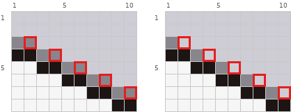
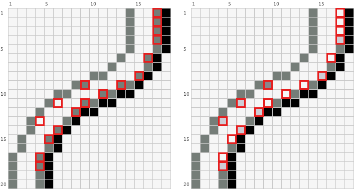
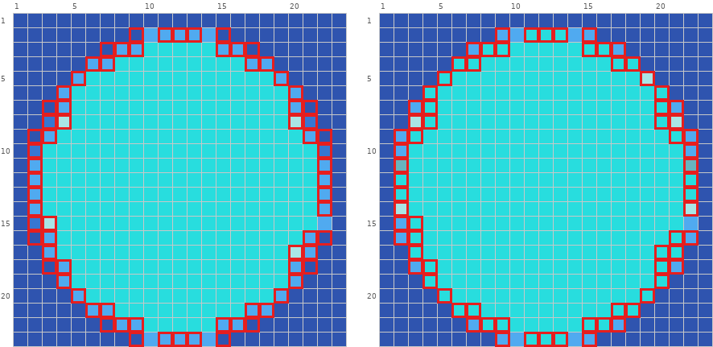

# 过渡色与颜色

过渡色（在台阶拐角放一格中间色）只是锦上添花。拼豆色号有限，豆子本身也有颗粒感，大多数时候不加更清楚。图纸上多出来的过渡色，多半是转换时伪像素边缘留下的模糊色，先怀疑它，再决定留不留。矩阵读法见 `pixel-repair-guide.md`。

## 1. 过渡色宁少勿多

**现象。** 斜线或台阶的每一段旁边都贴了一整段中间色，线条发虚变粗。

**判据。** 过渡色铺得和整段台阶一样长，或一段边缘用了 3 种以上过渡色。拼豆色号有限，豆子又有颗粒感，一段边缘超过 2 种过渡色，多半是转换残留。

**修法。** 每段台阶先按约一半长度留过渡色，靠近拐角的那一半；这是起点，不是上限，平缓的长台阶可以更长，短台阶可以更短，以缩小后看着顺为准。只留 1 到 2 种，多余的改回本色或底色。



坏（全图）：

```text
     1  2  3  4  5  6  7  8  9 10
  1  %  %  %  %  %  %  %  %  %  %
  2  %  %  %  %  %  %  %  %  %  %
  3  #  #  %  %  %  %  %  %  %  %
  4  @  @  #  #  %  %  %  %  %  %
  5  .  .  @  @  #  #  %  %  %  %
  6  .  .  .  .  @  @  #  #  %  %
  7  .  .  .  .  .  .  @  @  #  #
  8  .  .  .  .  .  .  .  .  @  @
```

好（全图）：

```text
     1  2  3  4  5  6  7  8  9 10
  1  %  %  %  %  %  %  %  %  %  %
  2  %  %  %  %  %  %  %  %  %  %
  3  #  %  %  %  %  %  %  %  %  %
  4  @  @  #  %  %  %  %  %  %  %
  5  .  .  @  @  #  %  %  %  %  %
  6  .  .  .  .  @  @  #  %  %  %
  7  .  .  .  .  .  .  @  @  #  %
  8  .  .  .  .  .  .  .  .  @  @
```

差异格：(3,2) `#`→`%`；(4,4) `#`→`%`；(5,6) `#`→`%`；(6,8) `#`→`%`；(7,10) `#`→`%`。

图例（颜色为示意，按作用对应到自己图纸的颜色）：

```text
@  #1D1414  墨黑色
#  #89858C  中灰
%  #CECDD5  银灰色
.  空位
```

黑线 `@` 的台阶每段 2 格。坏例每段上方都贴了 2 格中灰 `#`，整条线读成一条灰边；好例每段只留拐角处 1 格 `#`，另一格改回背景的银灰 `%`。5 处，每处 1 格。

## 2. 避免色带

**现象。** 一排过渡色紧贴轮廓，和轮廓等长并排走，曲线显得方，线条显得粗。

**判据。** 两排格子紧贴同一条轮廓平行延伸、长度相同、起止对齐，缩小后像多了一圈边，线显得粗、曲线显得方。看的是这种机械跟随，不按固定格数起算。

**修法。** 从一端减一两格，或在转折处断开，只在台阶凹角处留过渡色；不要一圈一圈跟着轮廓走。



坏（全图）：

```text
     1  2  3  4  5  6  7  8  9 10 11 12 13 14 15 16 17 18
  1  .  .  .  .  .  .  .  .  .  .  .  .  .  #  .  .  #  @
  2  .  .  .  .  .  .  .  .  .  .  .  .  .  #  .  .  #  @
  3  .  .  .  .  .  .  .  .  .  .  .  .  .  #  .  .  #  @
  4  .  .  .  .  .  .  .  .  .  .  .  .  .  #  .  .  #  @
  5  .  .  .  .  .  .  .  .  .  .  .  .  .  #  .  .  #  @
  6  .  .  .  .  .  .  .  .  .  .  .  .  #  .  .  #  @  .
  7  .  .  .  .  .  .  .  .  .  .  .  #  .  .  .  #  @  .
  8  .  .  .  .  .  .  .  .  .  #  #  .  .  .  #  @  .  .
  9  .  .  .  .  .  .  .  #  #  .  .  .  #  #  @  .  .  .
 10  .  .  .  .  .  #  #  .  .  .  #  #  @  @  .  .  .  .
 11  .  .  .  .  #  .  .  .  #  #  @  @  .  .  .  .  .  .
 12  .  .  .  #  .  .  .  #  @  @  .  .  .  .  .  .  .  .
 13  .  .  #  .  .  .  #  @  .  .  .  .  .  .  .  .  .  .
 14  .  .  #  .  .  #  @  .  .  .  .  .  .  .  .  .  .  .
 15  .  #  .  .  #  @  .  .  .  .  .  .  .  .  .  .  .  .
 16  .  #  .  .  #  @  .  .  .  .  .  .  .  .  .  .  .  .
 17  #  .  .  #  @  .  .  .  .  .  .  .  .  .  .  .  .  .
 18  #  .  .  #  @  .  .  .  .  .  .  .  .  .  .  .  .  .
 19  #  .  .  #  @  .  .  .  .  .  .  .  .  .  .  .  .  .
 20  #  .  .  #  @  .  .  .  .  .  .  .  .  .  .  .  .  .
```

好（全图）：

```text
     1  2  3  4  5  6  7  8  9 10 11 12 13 14 15 16 17 18
  1  .  .  .  .  .  .  .  .  .  .  .  .  .  #  .  .  .  @
  2  .  .  .  .  .  .  .  .  .  .  .  .  .  #  .  .  .  @
  3  .  .  .  .  .  .  .  .  .  .  .  .  .  #  .  .  .  @
  4  .  .  .  .  .  .  .  .  .  .  .  .  .  #  .  .  &  @
  5  .  .  .  .  .  .  .  .  .  .  .  .  .  #  .  .  #  @
  6  .  .  .  .  .  .  .  .  .  .  .  .  #  .  .  .  @  .
  7  .  .  .  .  .  .  .  .  .  .  .  #  .  .  .  #  @  .
  8  .  .  .  .  .  .  .  .  .  #  #  .  .  .  &  @  .  .
  9  .  .  .  .  .  .  .  #  %  .  .  .  .  #  @  .  .  .
 10  .  .  .  .  .  #  #  .  .  .  .  #  @  @  .  .  .  .
 11  .  .  .  .  #  &  .  .  .  #  @  @  .  .  .  .  .  .
 12  .  .  .  #  .  .  .  &  @  @  .  .  .  .  .  .  .  .
 13  .  .  #  &  .  .  #  @  .  .  .  .  .  .  .  .  .  .
 14  .  .  #  .  .  &  @  .  .  .  .  .  .  .  .  .  .  .
 15  .  #  .  .  .  @  .  .  .  .  .  .  .  .  .  .  .  .
 16  .  #  .  .  #  @  .  .  .  .  .  .  .  .  .  .  .  .
 17  #  .  .  .  @  .  .  .  .  .  .  .  .  .  .  .  .  .
 18  #  .  .  &  @  .  .  .  .  .  .  .  .  .  .  .  .  .
 19  #  .  .  #  @  .  .  .  .  .  .  .  .  .  .  .  .  .
 20  #  .  .  #  @  .  .  .  .  .  .  .  .  .  .  .  .  .
```

差异格共 17 个，见图中红框。

图例（颜色为示意，按作用对应到自己图纸的颜色）：

```text
@  #000000  黑色
#  #757D78  中灰色
%  #89858C  中灰
&  #CECDD5  银灰色
.  空位
```

看右边那条黑线 `@`：坏例在它左侧贴了一整条中灰 `#`，从第 1 行一直跟到第 20 行（第 17 列第 1 到 5 行、第 16 列第 6、7 行……），和黑线形影不离；好例把这条色带拆掉，只在黑线转折的凹角处留下零星几格 `#` 或更浅的 `&`（如第 4 行第 17 列、第 8 行第 15 列、第 12 行第 8 列）。线立刻变细。

## 3. 平直的长段不加过渡色

**现象。** 圆形或大弧线的平直段（最上、最下、最左、最右那几格）也加了过渡色，轮廓在那里鼓出来，圆不圆。

**判据。** 过渡色出现在没有台阶的直段上。

**修法。** 直段上的过渡色改成主体色，过渡色只放在直段两端的台阶拐角。



坏（第 7–17 行、第 1–6 列）：

```text
     1  2  3  4  5  6
  7  @  @  @  %  8  8
  8  @  @  #  O  8  8
  9  @  @  %  8  8  8
 10  @  #  8  8  8  8
 11  @  %  8  8  8  8
 12  @  %  8  8  8  8
 13  @  %  8  8  8  8
 14  @  %  8  8  8  8
 15  @  #  O  8  8  8
 16  @  @  %  8  8  8
 17  @  @  %  8  8  8
```

好（第 7–17 行、第 1–6 列）：

```text
     1  2  3  4  5  6
  7  @  @  %  8  8  8
  8  @  @  O  8  8  8
  9  @  %  8  8  8  8
 10  @  %  8  8  8  8
 11  @  &  8  8  8  8
 12  @  8  8  8  8  8
 13  @  8  8  8  8  8
 14  @  O  8  8  8  8
 15  @  %  8  8  8  8
 16  @  %  8  8  8  8
 17  @  @  8  8  8  8
```

差异格：(7,3) `@`→`%`；(7,4) `%`→`8`；(8,3) `#`→`O`；(8,4) `O`→`8`；(9,2) `@`→`%`；(9,3) `%`→`8`；(10,2) `#`→`%`；(11,2) `%`→`&`；(12,2) `%`→`8`；(13,2) `%`→`8`；(14,2) `%`→`O`；(15,2) `#`→`%`；(15,3) `O`→`8`；(16,2) `@`→`%`；(16,3) `%`→`8`；(17,3) `%`→`8`。

图例（颜色为示意，按作用对应到自己图纸的颜色）：

```text
@  #2F54AF  靛蓝色
#  #3677D2  中蓝色
%  #50AAF0  浅钴蓝
&  #67B4BE  灰蓝绿
8  #28DDDE  青蓝色
O  #A9E5E5  浅青绿
.  空位
```

这是一个圆的左侧边。坏例第 2 列第 10 到 15 行整列都是过渡色（`#`/`%`），等于给最平的竖直段加了一层壳，缩小后这里鼓出来；好例第 2 列中段第 12、13 行直接是主体色 `8`，过渡色（`%`、`&`、`O`）只留在两端拐角。

## 4. 例外：确实需要补过渡色的时候

- **外轮廓外侧不加过渡色。** 判据：最外圈描边外侧多了一圈中间色豆。修法：拿掉，外轮廓保持硬边。像素画里外轮廓可以和背景色过渡，拼豆成品没有固定背景，外侧多一圈中间色只会让剪影变胖。过渡色只用在主体内部两块颜色的交界处。
- **高反差交界确实刺眼时，才补 1 格。** 判据：深色和很亮的颜色沿台阶直接相接，拐角处锯齿明显，而且底稿这里本来就有过渡。修法：在台阶凹角放 1 格中间明度的颜色。
- **很平的长台阶。** 段长 4 格以上的平缓台阶，可以把过渡色沿台阶拉长成一段（仍不超过台阶长度的一半）。只在底稿本来就这样画时照做。

## 5. 颜色

- **明暗顺序不能颠倒。** 判据：同一块受光面上，从亮到暗的几档颜色中间插进了一个更暗或更亮的色。修法：按明度排序，受光面放最亮、暗部放最暗，逐格对照底稿的明暗关系替换。
- **相邻结构撞色分不开。** 判据：头发和发带、帽子和头发用同一深色相接。修法：其中一方借一个图纸已用的、明度不同的颜色，拉开明度差。
- **几乎看不出差别的颜色。** 判据：框内有两个色号非常接近，或某个色只出现一两格当杂色。先确认它不是高光、反光、宝石这类有意点的一两格。修法：并进相邻的主体色。这既让画面干净，也让用户少买一种豆。整张图的色板可以精简到「肤色阴影和发色浅色共用一档、各部位高光共用一档、最深暗部统一成一种」，修复时同样优先复用已有色号。
- **散落的单格杂色。** 判据：一片区域里同色格不成块，到处是孤立的 1 格，像噪点或棋盘。孤立单格只是疑点：瞳孔、高光、卡槽、按钮、扣子都可能只有 1 格，对照底稿确认它不表达任何结构，才算杂色。修法：把确认是杂色的孤立格并进周围的大色块，让色块边缘利落。
