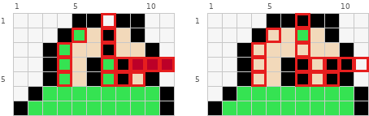
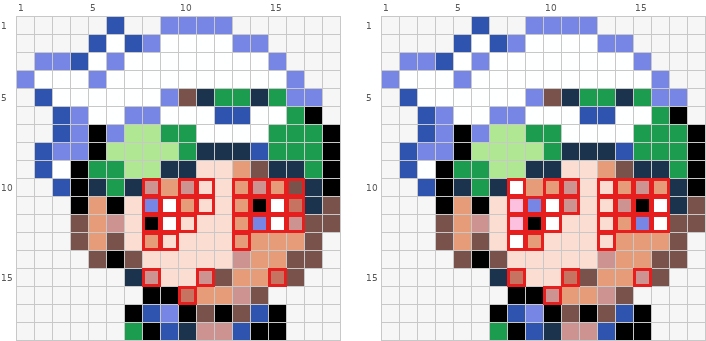
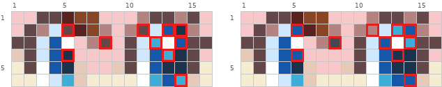
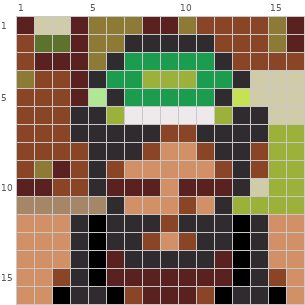

# 眼睛

观众先找眼睛来认脸，小图纸上最值得花格子的就是这里。一格的差别就能改变表情和视线，修复时保持底稿原表情，不要顺手改情绪。矩阵读法见 `pixel-repair-guide.md`。

## 1. 瞳孔和轮廓粘在一起

**现象。** 瞳孔与描边、眉毛、头发之间没有一格眼白或肤色隔开，深色连成长条，读不出是眼睛，可能被看成兔耳或裂缝。

**判据。** 沿瞳孔的深色格走一圈：只要有一边和外轮廓的深色格直接相连（上下左右任一方向），就是粘连。

**修法。** 把瞳孔和轮廓之间那一格改回眼白色，眼白区域内部的深色分割线全部去掉；瞳孔收成一个独立的方块（这个例子是 2×2）。



坏（全图）：

```text
     1  2  3  4  5  6  7  8  9 10 11
  1  .  .  .  .  @  @  .  @  @  .  .
  2  .  .  .  @  %  &  @  &  @  .  .
  3  .  .  @  %  &  &  @  &  &  @  .
  4  .  .  @  %  &  @  %  @  #  #  #
  5  .  .  @  %  &  @  %  @  &  @  .
  6  .  @  %  %  %  %  %  %  %  %  @
  7  @  %  %  %  %  %  %  %  %  %  @
```

好（全图）：

```text
     1  2  3  4  5  6  7  8  9 10 11
  1  8  8  8  8  @  @  @  @  @  8  8
  2  8  8  8  @  &  &  %  &  @  8  8
  3  8  8  @  &  &  &  &  &  &  @  8
  4  8  8  @  &  &  @  @  &  @  @  8
  5  8  8  @  &  &  @  @  &  @  @  8
  6  8  @  %  %  %  %  %  %  %  %  @
  7  @  %  %  %  %  %  %  %  %  %  @
```

差异格共 35 个，见图中红框。

图例（颜色为示意，按作用对应到自己图纸的颜色）：

```text
@  #000000  黑色
#  #BC0028  深酒红
%  #35E352  翠绿
&  #F2D9BA  浅奶茶
8  #FEFFFF  纯白
.  空位
```

坏例第 1 行的轮廓在第 7 列断开，成了两个凸起；第 2、3 行第 7 列的 `@` 从轮廓往下把眼白（`&`）竖着切成两半，左边眼白还混着身体绿色 `%`（第 2 到 5 行第 4 列），整体读成一对兔耳。好例第 1 行轮廓连成一整条，第 7 列的分割线去掉，眼白连成一块，瞳孔是第 4、5 行第 6、7 列的 2×2 `@`，上方和左右都有眼白隔开。

## 2. 眼睛贴着鬓角或脸侧（相切）

**现象。** 侧脸或四分之三脸的眼睛直接顶在发际、鬓角或脸的外轮廓上，两块深色共用一条边。

**判据。** 眼睛最外一格与头发、外轮廓的深色格之间是 0 格。中间至少要隔 1 格肤色，头发本身至少要 2 格宽才凸显得出来。

**修法。** 把整组眼睛（含眼白和高光）往脸内侧平移 1 格，腾出的那一列填肤色或发色。整组平移，不要只挪瞳孔，否则眼睛形状会变。



坏（第 9–13 行、第 4–18 列）：

```text
     4  5  6  7  8  9 10 11 12 13 14 15 16 17 18
  9  @  &  &  +  +  #  #  =  =  x  %  #  #  &  @
 10  @  #  &  #  o  x  o  =  =  x  o  x  %  #  @
 11  @  x  @  =  O  ~  x  =  =  x  @  ~  8  #  %
 12  %  x  o  =  @  ~  =  =  =  x  O  ~  o  %  %
 13  %  x  %  =  x  =  =  =  =  x  x  x  x  %  .
```

好（第 9–13 行、第 4–18 列）：

```text
     4  5  6  7  8  9 10 11 12 13 14 15 16 17 18
  9  @  &  &  +  +  #  #  =  =  x  %  #  #  &  @
 10  @  #  &  #  ~  x  x  o  =  =  x  o  x  #  @
 11  @  x  @  =  *  O  ~  o  =  =  o  @  ~  #  %
 12  %  x  o  =  *  @  ~  =  =  =  x  O  ~  %  %
 13  %  x  %  =  ~  x  =  =  =  =  x  x  x  %  ~
```

差异格共 26 个，见图中红框。

图例（颜色为示意，按作用对应到自己图纸的颜色）：

```text
@  #000000  黑色
#  #1C334D  深海军蓝
%  #78524B  深咖啡
&  #1C9C4F  森林绿
8  #C77362  赤陶色
O  #7786E5  中蓝紫
o  #CD9391  灰玫瑰
x  #E69C79  浅棕橙
*  #FEC0DF  浅粉色
+  #B0E792  苹果绿
=  #FCDDD2  浅蜜桃粉
~  #FEFFFF  纯白
.  空位
```

看第 11、12 行：坏例左眼（`O` 与 `@`）在第 8 列，和第 4 到 6 列的鬓角之间只隔一格肤色，头发挤成 1 格宽；好例把两只眼连同周围几格整体右移 1 列，左眼到了第 9 列，第 8 列补成浅肤色 `*`，右眼也从第 14 列移到第 15 列。表中零散的 `x`/`o` 互换是噪声，可忽略。

## 3. 高光的位置决定视线

**现象。** 瞳孔里那 1 格亮色挪一格，视线就从看前方变成看旁边，或者眼神变呆。

**判据。** 瞳孔的位置决定视线，高光表达反光和光源，两者分开看。同一光源下，两眼的高光通常在瞳孔的同一侧、同一高度。底稿瞳孔里有高光、图纸瞳孔是一整块深色时，就是高光被吞掉了。

**修法。** 逐只眼照底稿恢复：底稿哪只眼的哪一格是高光，就在那一格点回白色或最亮色。底稿只有一只眼有高光时，只点那一只，不要复制或镜像到另一只。

下面是同一双眼睛的两个方案（不是一好一坏），差别只在瞳孔里几格蓝色的深浅和位置。意思是：差几格就能改变眼神，两个都成立，缩小到原大看哪个更符合想要的视线。修复时按底稿选，不要自己换方案。



左（全图）：

```text
     1  2  3  4  5  6  7  8  9 10 11 12 13 14 15 16
  1  +  +  &  &  #  8  8  +  +  +  o  &  &  o  &  +
  2  +  &  o  =  &  #  8  o  +  o  &  =  O  @  o  +
  3  &  &  =  O  -  +  o  &  +  &  =  x  -  O  &  &
  4  *  &  =  O  @  +  +  +  +  &  =  O  x  @  &  +
  5  ~  &  -  O  @  *  +  +  *  &  -  O  @  @  &  ~
  6  ~  ~  -  =  x  *  ~  ~  ~  ~  -  x  O  x  *  ~
```

右（全图）：

```text
     1  2  3  4  5  6  7  8  9 10 11 12 13 14 15 16
  1  +  +  &  &  #  8  8  +  +  +  o  &  &  o  &  +
  2  +  &  o  =  O  #  8  o  +  o  o  =  x  O  o  +
  3  &  &  =  O  -  +  o  %  +  &  =  O  -  x  &  &
  4  *  &  =  O  O  +  +  +  +  &  =  O  @  @  &  +
  5  ~  &  -  O  @  *  +  +  *  &  -  O  @  @  &  ~
  6  ~  ~  -  =  x  *  ~  ~  ~  ~  -  x  O  O  *  ~
```

差异格：(2,5) `&`→`O`；(2,11) `&`→`o`；(2,13) `O`→`x`；(2,14) `@`→`O`；(3,8) `&`→`%`；(3,12) `x`→`O`；(3,14) `O`→`x`；(4,5) `@`→`O`；(4,13) `x`→`@`；(6,14) `x`→`O`。

图例（颜色为示意，按作用对应到自己图纸的颜色）：

```text
@  #1C334D  深海军蓝
#  #5A2121  暗红棕
%  #48464E  深灰
&  #644749  深暗紫
8  #8A4526  红棕色
O  #1557A8  深钴蓝
o  #B38281  灰玫瑰
x  #3CAED8  中海蓝
*  #E6C9B7  奶茶肤色
+  #F8C7C9  柔粉色
=  #CDE8FF  浅粉蓝
~  #F5ECD2  浅米色
-  #FEFFFF  纯白
.  空位
```

两边只差 10 格，集中在两只瞳孔内部：浅蓝 `x` 和较深的 `O`、`@` 换了位置，第 3 行第 8 列多了 1 格 `%`。两只眼的白色高光（第 3 行第 5、13 列的 `-`）两边都没动，说明视线是靠瞳孔里蓝色的深浅位置改的，不是靠挪高光。

## 4. 脸太小，根本放不下眼睛

**现象。** 脸只有 3 到 6 格宽，却硬塞了眼白和瞳孔，五官挤成一团深色杂斑。

**判据。** 眼白加瞳孔的画法至少要 2 格宽，两眼加间隔至少 5 格宽。脸放不下这个预算时，不要硬塞眼白和瞳孔。

**修法。** 按底稿的表情，换一种更省格子的画法：单格点、1 格宽的竖条、横放的闭眼线（见 `repair-face.md` 的小脸一节）；或者像下面的例子一样不画眼睛，用 1 到 2 格深肤色、帽檐阴影或发影横带过眼部，靠投影表现眼睛所在。



矩阵：

```text
     1  2  3  4  5  6  7  8  9 10 11 12 13 14 15 16
  1  %  =  =  %  O  O  O  %  %  O  &  &  &  &  O  %
  2  &  8  8  %  O  O  #  #  #  #  #  &  &  &  O  %
  3  &  %  %  %  O  #  o  o  o  o  o  #  &  &  &  &
  4  O  &  &  %  #  o  o  +  +  +  o  o  #  =  =  =
  5  &  &  &  %  -  #  o  o  o  o  o  #  ~  =  =  =
  6  &  &  &  #  #  +  :  :  :  :  :  +  #  #  =  =
  7  &  &  &  #  #  #  #  #  &  &  #  #  #  #  +  +
  8  &  &  &  &  #  #  #  &  *  *  &  #  #  &  +  +
  9  &  O  %  &  #  &  *  *  *  *  *  &  #  &  +  +
 10  %  %  &  &  #  %  %  %  *  %  %  %  #  =  +  +
 11  x  x  x  x  x  #  *  *  *  &  *  #  +  +  +  +
 12  *  *  *  #  @  #  #  #  &  #  #  #  @  #  *  *
 13  *  *  *  #  @  #  #  &  *  &  #  #  @  #  *  *
 14  *  *  *  #  @  %  #  #  #  #  #  %  @  #  *  *
 15  *  *  &  #  @  %  %  %  %  %  %  %  @  #  &  *
 16  *  *  @  #  #  @  &  %  %  %  &  @  #  #  @  *
```

图例（颜色为示意，按作用对应到自己图纸的颜色）：

```text
@  #000000  黑色
#  #2F2B2F  炭灰
%  #5A2121  暗红棕
&  #8A4526  红棕色
8  #5D722A  橄榄绿
O  #8D7A35  暗黄绿
o  #1C9C4F  森林绿
x  #A58767  棕褐色
*  #D19066  铜棕色
+  #9BB13A  黄橄榄绿
=  #D0CCAA  灰米色
~  #C5E254  亮黄绿
-  #B0E792  苹果绿
:  #EEE9EA  珍珠灰
.  空位
```

这是一个 16×16 的头像：帽子（第 2 到 6 行）下面，第 7 行第 4 到 14 列是一整条深色 `#` 阴影，第 8 行两侧还各有两三格 `#`，横过眼睛的位置；第 8 到 11 行中间才露出脸部肤色（`*`）。整张脸没有一格眼白或瞳孔，缩小后依然读得出「帽檐下的一张脸」。

## 5. 眼镜

**现象。** 镜框、镜片、眼珠、眉毛挤在两三行里，混成一片深色。

**修法。** 二选一，按底稿更突出哪一部分来选：

- **突出眼镜，舍掉眼睛。** 镜片整片填浅色（白或最亮的灰蓝），镜片里不放瞳孔。
- **只留镜框上沿。** 镜框只保留上沿 1 格深线，下沿和眼珠都并入肤色。

两种都不要同时画完整镜框和完整眼睛，格子不够。
