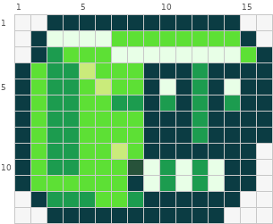
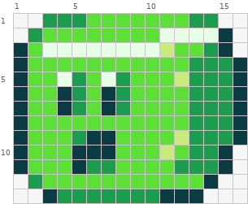
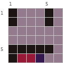
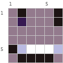
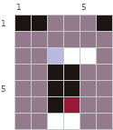
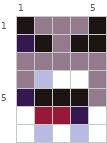
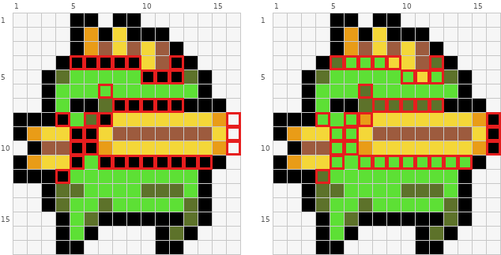
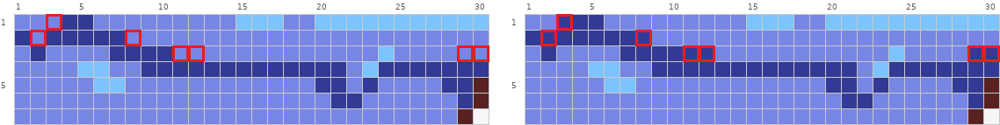
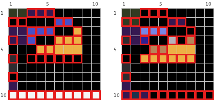

# 嘴与面部

眼睛之外，脸上最容易出事的是嘴和五官之间的间隔。修复时保持底稿原表情，不要顺手改情绪。眼睛单独见 `repair-eyes.md`，矩阵读法见 `pixel-repair-guide.md`。

## 1. 五官的暗区连成一片

**现象。** 眼睛、嘴巴、鼻影都用深色，彼此之间没有一格亮色隔开，整张脸读成一块黑斑，看不出哪是眼哪是嘴。

**判据。** 从眼睛的深色格出发，只走深色格（上下左右）能走到嘴，就是连成一片。眼睛和嘴之间至少要隔 1 格肤色或主体亮色，只要两边的深色走不通就行，不要求整行。嘴和鼻影、下巴描边之间同样至少隔 1 格。

**修法。** 在眼和嘴之间补出 1 格宽的亮色隔断，格子不够时把嘴往下或往上挪 1 格；嘴本身不要碰到下巴轮廓。

下面两个是同一只史莱姆（坏例和好例构图不同，不能逐格对照，分开看）。坏例：



矩阵：

```text
     1  2  3  4  5  6  7  8  9 10 11 12 13 14 15 16
  1  .  .  @  @  @  @  @  @  @  @  @  @  @  @  .  .
  2  .  @  O  O  O  O  &  &  &  &  &  &  &  &  @  .
  3  .  @  %  &  &  &  O  O  O  O  O  O  O  O  &  @
  4  @  &  %  %  8  &  &  &  @  @  @  %  @  @  @  @
  5  @  &  %  %  &  8  &  &  @  O  @  %  @  O  @  @
  6  @  &  %  %  &  &  %  %  @  %  @  %  @  %  @  @
  7  @  &  %  %  &  &  &  &  @  @  @  %  @  @  @  @
  8  @  &  %  %  &  &  &  &  @  @  @  %  @  @  @  @
  9  @  &  %  %  &  &  8  &  @  @  @  @  @  @  @  .
 10  @  &  %  %  &  &  &  #  O  %  O  %  O  @  @  .
 11  @  &  &  &  &  &  &  @  O  %  O  %  O  @  @  .
 12  .  @  %  %  %  &  &  %  @  @  @  @  @  @  .  .
 13  .  .  @  @  @  @  @  @  @  @  @  @  @  .  .  .
```

图例（颜色为示意，按作用对应到自己图纸的颜色）：

```text
@  #0B3C43  暗青色
#  #27523A  深森林绿
%  #1C9C4F  森林绿
&  #5DE035  亮翠绿
8  #CAEB7B  浅酸橙绿
O  #E8FFE7  极浅薄荷
.  空位
```

坏例的脸部是第 4 到 12 行、第 9 到 15 列的一大块暗青 `@`。眼睛（第 5、6 行第 10、14 列的 `O`/`%`）和嘴（第 10、11 行第 9 到 13 列 `O`/`%` 交替的牙）都嵌在这块暗色里，中间没有亮色隔开，眼和嘴被读成同一个洞。

好例：



矩阵：

```text
     1  2  3  4  5  6  7  8  9 10 11 12 13 14 15 16
  1  .  .  #  #  #  %  %  %  %  %  %  %  #  #  .  .
  2  .  #  %  %  %  %  %  %  %  %  8  8  8  8  @  .
  3  @  %  8  8  8  8  8  8  8  8  &  %  %  #  @  .
  4  @  %  %  %  %  %  %  %  %  %  %  %  #  #  #  @
  5  @  %  %  8  #  %  8  #  %  %  %  &  #  #  #  @
  6  @  %  %  @  #  %  @  #  %  %  %  %  #  #  #  @
  7  @  %  %  @  #  %  @  #  %  %  %  %  #  #  #  @
  8  @  %  %  %  %  %  %  %  %  %  %  %  #  #  #  @
  9  @  %  %  %  #  @  @  %  %  %  %  &  #  #  #  @
 10  @  %  %  %  @  @  @  %  %  %  &  %  #  #  @  .
 11  @  %  %  %  @  #  #  %  %  %  %  #  #  #  @  .
 12  .  #  %  %  %  %  %  %  %  %  %  %  %  @  .  .
 13  .  .  @  #  #  #  #  #  #  #  @  @  @  .  .  .
```

图例（颜色为示意，按作用对应到自己图纸的颜色）：

```text
@  #0B3C43  暗青色
#  #1C9C4F  森林绿
%  #5DE035  亮翠绿
&  #CAEB7B  浅酸橙绿
8  #E8FFE7  极浅薄荷
.  空位
```

好例的身体主体换成亮翠绿 `%`。眼睛是第 5 到 7 行第 4、5 列和第 7、8 列两个独立的小块（上 `8` 下 `@`/`#`），嘴是第 9 到 11 行第 5 到 7 列的 `@`。第 8 行第 2 到 11 列整行 `%`，把眼和嘴分开；嘴下方第 12 行也是 `%`，嘴没有碰到下巴轮廓。

## 2. 脸很小时，只靠嘴形表达表情

**现象。** 脸只有 5 到 7 格宽，却想画出眉、眼白、瞳孔、牙齿，格子不够，表情反而读不出来。

**判据。** 脸宽 ≤7 格时，眼白加瞳孔的画法放不下，要先选一种简化。

**修法。** 先确定这张脸必须看清的是什么（表情、视线还是某个标志），格子先给它。眼睛按底稿的表情选一种省格子的画法：1 格宽 2 格高的深色竖条、单格点、横放的闭眼线、斜折的怒眼。表情差异主要放在嘴：一行深色是闭嘴，深色框里放 1 到 2 格红色是张嘴，深色框里放白格是露牙。眉毛只在需要愤怒、惊讶时用 1 格斜放。

同一张脸的四种表情，都是 6 到 7 行：



矩阵：

```text
     1  2  3  4  5  6
  1  @  &  &  &  @  &
  2  @  &  &  &  @  &
  3  &  &  &  &  &  &
  4  &  &  &  &  &  &
  5  @  @  @  @  @  &
  6  @  %  %  #  &  &
```

图例（颜色为示意，按作用对应到自己图纸的颜色）：

```text
@  #1D1414  墨黑色
#  #361851  深紫黑
%  #971937  暗血红
&  #937A8D  暗灰紫
.  空位
```

普通张嘴：双眼是第 1、2 行第 1 列和第 5 列的 `@` 竖条；嘴是第 5 行一整条深色加第 6 行深色包住的 `%` 红格。



矩阵：

```text
     1  2  3  4  5  6
  1  %  @  %  %  %  @
  2  %  #  %  %  %  @
  3  %  %  %  %  %  %
  4  %  %  %  %  %  %
  5  @  &  8  8  8  &
  6  %  @  @  @  @  %
```

图例（颜色为示意，按作用对应到自己图纸的颜色）：

```text
@  #1D1414  墨黑色
#  #361851  深紫黑
%  #937A8D  暗灰紫
&  #B9BAE1  灰蓝紫
8  #FEFFFF  纯白
.  空位
```

露齿笑：嘴是第 5 行两端 `@`/`&` 夹住 3 格纯白 `8`（白牙），第 6 行深色托底。



矩阵：

```text
     1  2  3  4  5  6
  1  @  @  %  %  %  @
  2  %  %  %  %  %  %
  3  %  %  &  8  8  %
  4  %  %  @  @  %  %
  5  %  %  @  @  %  %
  6  %  %  @  #  %  %
  7  %  %  8  8  %  %
```

图例（颜色为示意，按作用对应到自己图纸的颜色）：

```text
@  #1D1414  墨黑色
#  #971937  暗血红
%  #937A8D  暗灰紫
&  #B9BAE1  灰蓝紫
8  #FEFFFF  纯白
.  空位
```

一睁一闭加大张嘴：左眼是第 1 行横放的 2 格 `@`（闭眼），右眼只剩 1 格；嘴纵向拉长到第 3 到 7 行，上下两端的白格 `8` 是牙，中间深色是口腔，第 6 行 1 格 `#` 是舌头。



矩阵：

```text
     1  2  3  4  5
  1  @  &  &  &  @
  2  #  @  &  @  @
  3  &  &  &  &  &
  4  &  8  O  O  &
  5  #  @  @  @  &
  6  O  %  %  #  O
  7  O  8  O  8  O
```

图例（颜色为示意，按作用对应到自己图纸的颜色）：

```text
@  #1D1414  墨黑色
#  #361851  深紫黑
%  #971937  暗血红
&  #937A8D  暗灰紫
8  #B9BAE1  灰蓝紫
O  #FEFFFF  纯白
.  空位
```

大喊：第 2 行多了斜向的深色眉毛；嘴占第 4 到 7 行，第 4 行的 `O` 当上牙，第 5 行深色，第 6 行 `%` 当口腔，第 6、7 行两侧和中间的 `O` 是下牙。

四张图的眼睛都只用 1 到 2 格，画法随表情换（竖条、闭眼线、单格、怒眼），表情主要靠嘴的 4 到 8 格。修复小脸时先保住嘴形；眼睛照底稿用的那种简化来修，不要统一换成竖条。

## 3. 面部内的黑线改成色块交界

**现象。** 嘴、腮、鳍和脸的交界处画了 1 格纯黑内线，脸被切成几块，显得粗笨拥挤。

**判据。** 主体内部两块颜色已经能靠色相或明度分开（如黄嘴和绿脸），中间却还夹着一条纯黑线。

**修法。** 去掉内线，让两块颜色直接相接；需要加强分界时，用相邻色块中较深的那一档代替黑色。外轮廓的黑线保留。



坏（全图）：

```text
     1  2  3  4  5  6  7  8  9 10 11 12 13 14 15 16
  1  o  o  o  o  @  @  o  @  @  o  o  o  o  o  o  .
  2  o  o  o  o  @  &  @  O  @  @  @  o  o  o  o  .
  3  o  o  o  o  @  &  %  O  %  O  %  @  o  o  o  .
  4  o  o  o  @  @  @  @  @  @  O  %  @  @  o  o  .
  5  o  o  @  #  8  8  8  8  8  @  @  @  #  @  o  .
  6  o  o  @  8  8  8  8  8  8  8  8  8  8  @  o  .
  7  o  o  @  8  @  @  #  @  @  @  @  @  @  @  @  .
  8  @  @  @  @  8  #  @  O  O  O  O  O  O  O  &  .
  9  @  &  O  O  @  @  O  %  %  %  %  %  %  %  O  .
 10  o  @  %  %  @  @  &  O  O  O  O  O  O  O  &  .
 11  @  &  O  O  @  8  @  @  @  @  @  @  @  @  @  .
 12  @  @  @  @  8  8  8  8  8  8  8  8  8  @  o  .
 13  o  o  @  #  #  8  8  8  8  #  #  #  8  @  o  .
 14  o  o  @  #  8  8  #  8  8  8  8  8  #  @  o  .
 15  o  o  o  @  8  #  @  @  @  @  @  @  #  @  o  .
 16  o  o  o  @  8  @  o  o  o  o  @  #  @  o  o  .
 17  o  o  o  @  @  o  o  o  o  o  @  @  o  o  o  .
```

好（全图）：

```text
     1  2  3  4  5  6  7  8  9 10 11 12 13 14 15 16
  1  .  .  .  .  @  @  .  @  @  .  .  .  .  .  .  .
  2  .  .  .  .  @  &  @  O  @  @  @  .  .  .  .  .
  3  .  .  .  .  @  &  %  O  %  O  %  @  .  .  .  .
  4  .  .  .  @  #  8  8  8  O  O  %  #  @  .  .  .
  5  .  .  @  #  8  8  8  8  8  8  O  8  #  @  .  .
  6  .  .  @  8  8  8  #  8  8  8  8  8  8  @  .  .
  7  .  .  @  8  @  @  #  #  #  #  #  #  @  @  @  .
  8  @  @  @  8  8  8  &  O  O  O  O  O  O  O  &  @
  9  @  &  O  O  8  8  O  %  %  %  %  %  %  %  O  @
 10  .  @  %  %  8  8  &  O  O  O  O  O  O  O  &  @
 11  @  &  O  O  8  8  8  8  8  8  8  8  8  8  @  .
 12  @  @  @  #  8  8  8  8  8  8  8  8  8  @  .  .
 13  .  .  @  #  #  8  8  8  8  #  #  #  8  @  .  .
 14  .  .  @  #  8  8  #  8  8  8  8  8  #  @  .  .
 15  .  .  .  @  8  #  @  @  @  @  @  @  #  @  .  .
 16  .  .  .  @  8  @  .  .  .  .  @  #  @  .  .  .
 17  .  .  .  @  @  .  .  .  .  .  @  @  .  .  .  .
```

差异格共 106 个，见图中红框。

图例（颜色为示意，按作用对应到自己图纸的颜色）：

```text
@  #000000  黑色
#  #5D722A  橄榄绿
%  #9D5B3E  深棕色
&  #E99C17  深焦糖
8  #5DE035  亮翠绿
O  #F4D738  向日葵黄
o  #FEFFFF  纯白
.  空位
```

坏例第 4、7、11 行各有一条 `@` 横穿脸部，第 5、6 列第 8 到 11 行还有一段竖线，把头顶、黄色嘴部（`O`/`%`）和下巴切开；好例这三行改回绿色 `8` 或深一档的橄榄绿 `#`，黄嘴和绿脸直接相接，第 7 行用 `#` 做嘴上沿的暗面。好例还在第 16 列第 8 到 10 行补上 3 格 `@`，让右侧鱼鳍的外轮廓闭合：内线删掉，外轮廓补齐。

## 4. 嘴缝的颜色决定线的粗细

**现象。** 一条嘴缝显得太粗像胡子，或太淡看不见。

**判据。** 嘴通常就是一条线：颜色越深显得越粗、越清楚，越接近肤色显得越细。嘴缝和周围肤色的明度差太小，就是轮廓不清。

**修法。** 不加格，换颜色。嘴缝中段用深一档的颜色，嘴角用浅一档收尾，自然渐尖。



坏（第 1–4 行、第 1–24 列）：

```text
     1  2  3  4  5  6  7  8  9 10 11 12 13 14 15 16 17 18 19 20 21 22 23 24
  1  #  #  #  @  @  #  #  #  #  #  #  #  #  #  %  %  %  #  #  %  %  %  %  %
  2  @  #  @  @  @  @  @  #  #  #  #  #  #  #  #  #  #  #  #  #  #  #  #  #
  3  #  @  #  #  #  #  @  @  @  @  #  #  #  #  #  #  #  #  #  #  #  #  #  %
  4  #  #  #  #  %  %  #  #  @  @  @  @  @  @  @  @  @  @  @  @  @  #  %  @
```

好（第 1–4 行、第 1–24 列）：

```text
     1  2  3  4  5  6  7  8  9 10 11 12 13 14 15 16 17 18 19 20 21 22 23 24
  1  #  #  @  @  @  #  #  #  #  #  #  #  #  #  %  %  %  #  #  %  %  %  %  %
  2  @  @  @  @  @  @  @  @  #  #  #  #  #  #  #  #  #  #  #  #  #  #  #  #
  3  #  @  #  #  #  #  @  @  @  @  @  @  #  #  #  #  #  #  #  #  #  #  #  %
  4  #  #  #  #  %  %  #  #  @  @  @  @  @  @  @  @  @  @  @  @  @  #  %  @
```

差异格：(1,3) `#`→`@`；(2,2) `#`→`@`；(2,8) `#`→`@`；(3,11) `#`→`@`；(3,12) `#`→`@`。

图例（颜色为示意，按作用对应到自己图纸的颜色）：

```text
@  #333A95  暗靛紫
#  #7786E5  中蓝紫
%  #7CC4FF  婴儿蓝
.  空位
```

这是放大的嘴部特写，两边形状完全相同，只有 7 格从 `#` 换成更深的 `@`：都在嘴缝最关键的几处（第 1 行第 3 列、第 2 行第 2 和第 8 列、第 3 行第 11、12、29、30 列），把唇缝的转折点压深。一格都没加，线就清楚了。

## 5. 小头像里的黑线太多

**现象。** 10 格左右的头像，眼周、鼻、嘴都用纯黑勾了一圈，深色格占了半张脸，五官挤成一团。

**判据。** 脸只有十几格宽，却同时出现眉、上下眼眶、眼白、瞳孔、鼻、嘴，深色格连成杂斑。

**修法。** 删去次要细节（鼻子、眼眶下沿、嘴唇轮廓），眼睛收成 1 到 2 格纯色，嘴收成 1 到 3 格。肤色块要连成一片。



坏（第 1–9 行、第 1–10 列）：

```text
     1  2  3  4  5  6  7  8  9 10
  1  8  8  #  #  #  @  @  @  @  @
  2  @  @  @  @  @  O  O  @  @  @
  3  #  #  O  O  O  @  @  +  @  @
  4  #  #  O  @  @  +  +  +  @  @
  5  @  @  @  +  +  +  +  +  @  @
  6  %  @  @  @  @  @  @  @  @  @
  7  %  @  @  @  @  @  @  @  @  @
  8  @  @  @  @  @  @  @  @  @  @
  9  #  @  @  @  @  @  @  @  @  @
```

好（第 1–9 行、第 1–10 列）：

```text
     1  2  3  4  5  6  7  8  9 10
  1  8  8  @  @  @  @  @  @  @  @
  2  8  8  @  @  @  #  #  @  @  @
  3  #  #  o  o  o  @  @  @  @  @
  4  %  #  &  @  @  *  @  x  @  @
  5  @  @  @  x  x  +  +  +  @  @
  6  @  @  +  +  +  +  +  +  @  @
  7  %  @  @  @  @  @  @  @  @  @
  8  %  @  @  @  @  @  @  @  @  @
  9  #  @  @  @  @  @  @  @  @  @
```

差异格共 26 个，见图中红框。

图例（颜色为示意，按作用对应到自己图纸的颜色）：

```text
@  #000000  黑色
#  #361851  深紫黑
%  #2F2B2F  炭灰
&  #2F1F90  深蓝紫
8  #303A21  暗橄榄
O  #494FC7  深蓝紫
o  #7786E5  中蓝紫
x  #B88558  浅木棕
*  #B6B1BA  浅灰紫
+  #EDB045  焦糖色
.  空位
```

坏例的黑线和深色把脸切碎：第 2 行左半是一条 `@`，眼睛的 `O` 散成两块（第 2 行第 6、7 列，第 3、4 行第 3 到 5 列），第 4 行第 4、5 列又是黑格，肤色 `+` 只剩第 4、5 行零散几格。好例眼睛收成第 3 行一条 3 格的 `o`，第 4 行第 6 列 `*`、第 8 列 `x` 两格亮点当眼神，肤色在第 5、6 行连成 11 格的一整块。这一对差异格较多（好例是整个头像重画），借鉴方向即可，不要当作改格数量的参考。

## 6. 脸上的过渡杂色

**现象。** 五官内部或紧贴五官处有半深不浅的过渡色格，让五官发糊。

**修法。** 面部以清楚为先。这类杂色多是转换时伪像素边缘留下的，对照底稿确认后改回肤色或线色。底稿里有意画的过渡（勾出眼形、嘴角渐尖的那一两格）保留。
