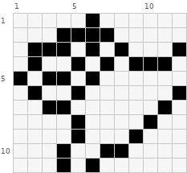
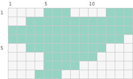
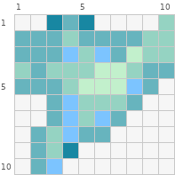
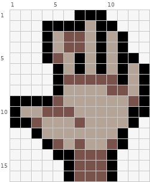
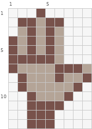
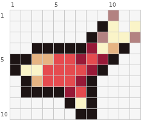
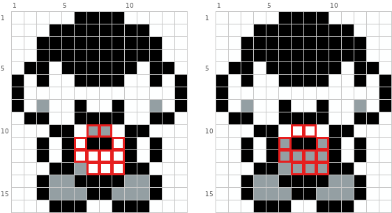
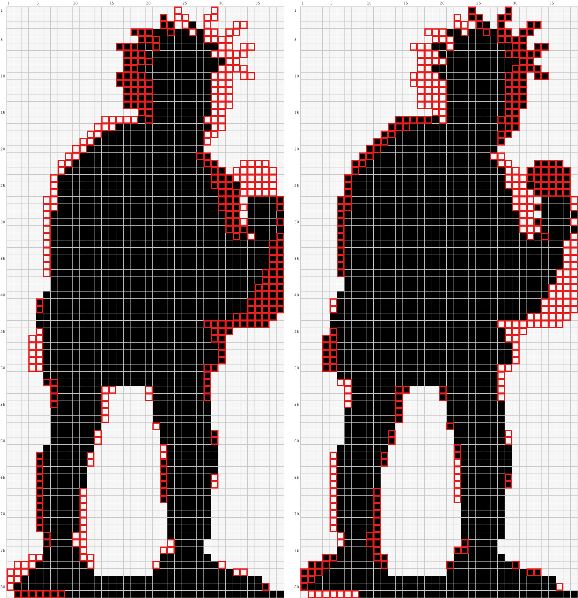

# 手、小物件与剪影

手和手里的东西通常只有几格大，最容易被描边吃掉或糊成一团。小图纸上，剪影比内部细节重要。矩阵读法见 `pixel-repair-guide.md`。

## 1. 先有实心剪影，再谈手指

**现象。** 手用黑线一根根勾出手指，线挤成一团，轮廓还断断续续。

**判据。** 手只有 3 到 12 格宽，内部的深色线格多于手本身的颜色格。

**修法。** 去掉手指间的深色，整只手先用一种实色归纳成连指手套状的块，确认剪影读得出手势；需要区分手指时，用受光色和背光色相邻交替，而不是加线。

坏：只用黑线画手。



矩阵：

```text
     1  2  3  4  5  6  7  8  9 10 11 12
  1  .  .  .  .  .  @  .  .  .  .  .  .
  2  .  .  .  @  @  @  @  .  .  .  .  .
  3  .  @  @  @  .  @  .  @  .  .  .  @
  4  .  @  .  .  @  .  @  .  @  @  @  .
  5  @  .  @  @  .  @  .  .  .  .  .  .
  6  .  @  .  .  @  .  .  .  .  .  .  @
  7  .  .  @  @  .  .  .  .  .  .  @  .
  8  .  .  .  .  @  .  .  .  .  @  .  .
  9  .  .  .  .  @  .  .  .  @  .  .  .
 10  .  .  .  @  .  .  @  @  .  .  .  .
 11  .  .  .  @  .  @  .  .  .  .  .  .
```

图例（颜色为示意，按作用对应到自己图纸的颜色）：

```text
@  #000000  黑色
.  空位
```

整张图只有 `@` 和空位，线在第 3 到 6 行反复折返，手指数不清，轮廓也是断的（第 5 行第 1 列、第 6 行第 2 列与上下不相连）。

第一步：一整片实色剪影。



矩阵：

```text
     1  2  3  4  5  6  7  8  9 10 11 12 13 14
  1  .  .  .  .  @  @  @  .  .  .  .  @  @  @
  2  .  .  @  @  @  @  @  @  @  @  @  @  @  @
  3  @  @  @  @  @  @  @  @  @  @  @  @  @  @
  4  @  @  @  @  @  @  @  @  @  @  @  @  @  .
  5  .  .  @  @  @  @  @  @  @  @  @  .  .  .
  6  .  .  .  .  @  @  @  @  @  @  .  .  .  .
  7  .  .  .  .  @  @  @  @  .  .  .  .  .  .
  8  .  .  .  @  @  @  .  .  .  .  .  .  .  .
```

图例（颜色为示意，按作用对应到自己图纸的颜色）：

```text
@  #95D3C2  灰绿
.  空位
```

全部是灰绿 `@`，没有一格线，但第 1 行两个凸起（第 5 到 7 列和第 12 到 14 列）已经读得出伸出的手指，第 6 到 8 行收窄成手腕。

完成：在剪影上加明暗。



矩阵：

```text
     1  2  3  4  5  6  7  8  9 10
  1  .  .  @  #  @  .  .  .  .  &
  2  #  #  #  &  #  #  #  #  &  &
  3  #  #  #  %  &  %  #  8  &  &
  4  &  #  &  &  &  8  8  &  #  #
  5  #  #  #  &  8  8  8  %  #  .
  6  .  .  #  %  &  &  &  #  .  .
  7  .  .  #  %  &  %  #  .  .  .
  8  .  #  &  %  #  #  .  .  .  .
  9  .  #  &  @  .  .  .  .  .  .
 10  .  #  %  .  .  .  .  .  .  .
```

图例（颜色为示意，按作用对应到自己图纸的颜色）：

```text
@  #1887A2  深湖蓝
#  #67B4BE  灰蓝绿
%  #7CC4FF  婴儿蓝
&  #95D3C2  灰绿
8  #C2F0CC  浅薄荷绿
.  空位
```

外形和剪影一致；手指之间靠几档绿色、蓝色（`&`、`8`、`#`、`%`）相邻来分，没有一格黑缝。

## 2. 手越小，越不能用黑缝

**现象。** 缩小后的手仍沿用大图的画法，指缝用 1 格黑线，手指粗细不一或糊成一团。

**判据。** 手宽 ≤7 格、手指只有 2 到 3 行高时，指缝不能用纯黑。

**修法。** 指缝改成手本身的暗色一档，与亮色一列一列交替。

大尺寸（13 格宽）可以用黑缝：



矩阵：

```text
     1  2  3  4  5  6  7  8  9 10 11 12 13
  1  .  .  .  .  .  .  @  @  @  .  .  .  .
  2  .  .  .  @  @  @  @  %  @  @  .  .  .
  3  .  .  .  @  %  #  #  %  @  %  @  .  .
  4  .  .  .  @  %  #  #  %  @  %  @  .  .
  5  .  .  .  @  #  %  @  %  @  %  @  @  .
  6  .  .  .  .  @  %  @  %  @  %  @  %  @
  7  .  .  .  .  @  #  #  #  #  #  @  %  @
  8  .  .  .  .  @  %  %  %  %  #  #  %  @
  9  @  @  @  @  #  %  %  %  %  %  %  #  @
 10  @  %  %  #  #  #  %  %  %  %  %  @  @
 11  @  @  #  %  %  %  #  %  %  %  %  @  .
 12  .  .  @  %  %  %  %  %  %  %  @  .  .
 13  .  .  .  @  #  %  #  %  %  #  @  .  .
 14  .  .  .  .  @  @  #  #  #  @  .  .  .
 15  .  .  .  .  .  @  #  #  #  @  .  .  .
 16  .  .  .  .  .  @  #  #  #  @  .  .  .
```

图例（颜色为示意，按作用对应到自己图纸的颜色）：

```text
@  #000000  黑色
#  #78524B  深咖啡
%  #B4A497  灰棕色
.  空位
```

第 3 到 6 行第 7 到 11 列，`@` 和 `%` 一列一列交替，黑线把手指分开。

同一只手缩到 9 格宽，不再用黑：



矩阵：

```text
     1  2  3  4  5  6  7  8  9
  1  .  .  .  @  .  .  .  .  .
  2  .  @  @  #  @  @  .  .  .
  3  .  #  @  #  @  #  .  .  .
  4  @  #  @  #  @  #  .  .  .
  5  @  #  @  #  @  #  .  .  .
  6  @  @  @  @  @  #  .  .  .
  7  @  #  #  #  #  @  @  @  #
  8  .  @  #  #  #  @  #  #  @
  9  .  @  #  #  #  #  #  @  .
 10  .  .  @  #  #  #  @  .  .
 11  .  .  @  @  @  @  .  .  .
 12  .  .  @  @  @  .  .  .  .
 13  .  .  @  @  @  .  .  .  .
```

图例（颜色为示意，按作用对应到自己图纸的颜色）：

```text
@  #78524B  深咖啡
#  #B4A497  灰棕色
.  空位
```

第 2 到 6 行第 2 到 6 列改成深咖啡 `@` 和灰棕 `#` 交替：两档棕色相邻，手指照样分得开，整只手没有一格黑。

手指只有 3 行高时的完整例子：



矩阵：

```text
     1  2  3  4  5  6  7  8  9 10 11 12
  1  .  .  .  .  .  .  .  .  .  &  .  .
  2  .  .  .  .  .  .  .  .  @  O  .  O
  3  .  .  .  .  .  .  .  @  &  O  O  &
  4  .  .  @  @  @  @  @  #  O  8  @  .
  5  @  @  8  8  %  %  #  %  #  @  .  .
  6  @  O  O  %  %  %  %  #  @  .  .  .
  7  .  @  8  %  %  %  #  @  .  .  .  .
  8  .  @  @  @  @  #  %  @  .  .  .  .
  9  .  .  .  .  .  @  O  @  .  .  .  .
 10  .  .  .  .  .  .  @  @  .  .  .  .
```

图例（颜色为示意，按作用对应到自己图纸的颜色）：

```text
@  #1D1414  墨黑色
#  #971937  暗血红
%  #E54B4F  中红色
&  #B38281  灰玫瑰
8  #E6B483  肉桂棕
O  #FAF4C8  奶油米黄
.  空位
```

手指在第 5 到 7 行，靠 `%`（亮）和 `#`（暗）交替分开；黑色 `@` 只出现在最外圈轮廓上。

## 3. 看不出手势

**判据。** 格子不够画全五指时，平均分配反而看不出姿势。

**修法。** 优先保住拇指和食指的伸出方向，其余手指合成一块。对照底稿，伸出的那一两根手指至少要凸出剪影 1 格。

## 4. 小物件认不出是什么

**现象。** 手里只有几格大的道具只是一块色，可能被看成杯子或别的东西。

**判据。** 盖住周围只看这几格，说不出是什么东西。

**修法。** 在最有代表性的位置补 1 到 2 格深线或亮线点出特征（底稿里有的才补），主体色和高光色也要按物件本身的材质来。

下面是同一个人物手里的道具（坏例和好例人物完全一样，只差手里的东西）：



坏（全图）：

```text
     1  2  3  4  5  6  7  8  9 10 11 12 13 14
  1  %  %  %  %  %  @  @  @  @  %  %  %  %  %
  2  %  %  %  @  @  @  @  @  @  @  @  %  %  %
  3  %  %  @  @  @  @  @  @  @  @  @  @  %  %
  4  %  %  @  @  @  @  @  @  @  @  @  @  %  %
  5  %  @  @  %  @  @  @  @  @  @  %  @  @  %
  6  @  %  @  %  %  @  @  @  @  %  %  @  %  @
  7  @  %  %  %  %  %  %  %  %  %  %  %  %  @
  8  @  %  #  %  %  @  %  %  @  %  %  #  %  @
  9  %  @  @  %  %  @  @  @  @  %  %  @  @  %
 10  %  %  %  @  @  %  #  #  %  @  @  %  %  %
 11  %  %  @  %  @  %  @  @  %  @  %  @  %  %
 12  %  %  @  %  @  %  %  %  %  @  %  @  %  %
 13  %  %  %  @  @  #  %  %  %  @  @  %  %  %
 14  %  %  @  #  #  @  @  @  @  #  #  @  %  %
 15  %  %  @  #  #  #  @  @  #  #  #  @  %  %
 16  %  %  %  @  @  @  %  %  @  @  @  %  %  %
```

好（全图）：

```text
     1  2  3  4  5  6  7  8  9 10 11 12 13 14
  1  %  %  %  %  %  @  @  @  @  %  %  %  %  %
  2  %  %  %  @  @  @  @  @  @  @  @  %  %  %
  3  %  %  @  @  @  @  @  @  @  @  @  @  %  %
  4  %  %  @  @  @  @  @  @  @  @  @  @  %  %
  5  %  @  @  %  @  @  @  @  @  @  %  @  @  %
  6  @  %  @  %  %  @  @  @  @  %  %  @  %  @
  7  @  %  %  %  %  %  %  %  %  %  %  %  %  @
  8  @  %  #  %  %  @  %  %  @  %  %  #  %  @
  9  %  @  @  %  %  @  @  @  @  %  %  @  @  %
 10  %  %  %  @  @  %  %  %  %  @  @  %  %  %
 11  %  %  @  %  @  #  @  @  #  @  %  @  %  %
 12  %  %  @  %  @  #  #  #  #  @  %  @  %  %
 13  %  %  %  @  @  #  #  #  #  @  @  %  %  %
 14  %  %  @  #  #  @  @  @  @  #  #  @  %  %
 15  %  %  @  #  #  #  @  @  #  #  #  @  %  %
 16  %  %  %  @  @  @  %  %  @  @  @  %  %  %
```

差异格：(10,7) `#`→`%`；(10,8) `#`→`%`；(11,6) `%`→`#`；(11,9) `%`→`#`；(12,6) `%`→`#`；(12,7) `%`→`#`；(12,8) `%`→`#`；(12,9) `%`→`#`；(13,7) `%`→`#`；(13,8) `%`→`#`；(13,9) `%`→`#`。

图例（颜色为示意，按作用对应到自己图纸的颜色）：

```text
@  #000000  黑色
#  #949FA3  钢灰色
%  #FEFFFF  纯白
.  空位
```

道具在第 10 到 13 行第 6 到 9 列，两边第 11 行第 7、8 列都有 2 格黑色 `@`。坏例主体是浅灰白 `%`，第 10 行中间两格却是深的钢灰 `#`，黑格看起来像杯口，整体读成一只白杯子。好例反过来：主体改成钢灰 `#`，顶上第 10 行整条 `%` 当亮边，那 2 格黑色落在灰色机身上，读成卡槽，立刻是游戏掌机。没有加一格，只是把 11 格的深浅对调。

## 5. 小部件被描边吃掉

**判据。** 箱角、扣子、武器护手这类只有几格大的结构，每条边都描了深线，内部没剩几格。

**修法。** 去掉整圈描边，受光一侧改成最亮色、缝隙处 1 格最暗色，用明暗直接切出形体。

## 6. 肢体和躯干粘成一块

**现象。** 手、腿、武器、马尾紧贴身体，外轮廓被填平，看不出动作。

**判据。** 把这一块整片涂成一种颜色看剪影：手和身体之间没有空位，读不出手在哪。

**修法。** 在贴合处把外缘几格改成空位挖出缝隙，让肢体形成独立凸出的轮廓。只在主体内部挖，不往外加豆。

同一角色两个版本的剪影（全图 81×38，下面只截手腕附近）：



坏（第 20–36 行、第 26–38 列）：

```text
    26 27 28 29 30 31 32 33 34 35 36 37 38
 20  @  @  .  .  .  .  .  .  .  .  .  .  .
 21  @  @  @  .  .  .  .  .  .  .  .  .  .
 22  @  @  @  @  .  .  .  .  .  .  .  .  .
 23  @  @  @  @  @  .  .  .  .  .  .  .  .
 24  @  @  @  @  @  @  .  .  .  .  .  .  .
 25  @  @  @  @  @  @  @  .  .  .  .  .  .
 26  @  @  @  @  @  @  @  .  .  .  .  .  .
 27  @  @  @  @  @  @  @  .  @  @  @  @  @
 28  @  @  @  @  @  @  @  .  @  @  @  @  @
 29  @  @  @  @  @  @  @  .  @  @  @  @  @
 30  @  @  @  @  @  @  @  .  @  @  @  @  @
 31  @  @  @  @  @  @  @  @  @  @  @  @  @
 32  @  @  @  @  @  @  @  @  .  @  @  @  @
 33  @  @  @  @  @  @  @  @  @  @  @  @  @
 34  @  @  @  @  @  @  @  @  @  @  @  @  @
 35  @  @  @  @  @  @  @  @  @  @  @  @  @
 36  @  @  @  @  @  @  @  @  @  @  @  @  @
```

好（第 20–36 行、第 26–38 列）：

```text
    26 27 28 29 30 31 32 33 34 35 36 37 38
 20  @  @  .  .  .  .  .  .  .  .  .  .  .
 21  @  .  .  .  .  .  .  .  .  .  .  .  .
 22  @  @  .  .  .  .  .  @  @  @  @  .  .
 23  @  @  @  .  .  .  @  @  @  @  @  @  .
 24  @  @  @  .  .  .  @  @  @  @  @  @  .
 25  @  @  @  .  .  .  @  @  @  @  @  @  .
 26  @  @  @  @  .  .  .  @  @  @  @  @  .
 27  @  @  @  @  .  .  .  .  @  @  @  @  .
 28  @  @  @  @  .  .  .  @  @  @  @  @  .
 29  @  @  @  @  @  .  .  .  @  @  @  @  @
 30  @  @  @  @  @  .  .  @  @  @  @  @  .
 31  @  @  @  @  @  .  .  .  @  @  @  @  @
 32  @  @  @  @  @  @  .  @  @  @  @  @  .
 33  @  @  @  @  @  @  @  @  @  @  @  .  .
 34  @  @  @  @  @  @  @  @  @  @  @  .  .
 35  @  @  @  @  @  @  @  @  @  @  @  .  .
 36  @  @  @  @  @  @  @  @  @  @  @  .  .
```

差异格共 70 个，见图中红框。

图例（颜色为示意，按作用对应到自己图纸的颜色）：

```text
@  #000000  黑色
.  空位
```

坏例手和躯干之间只有零星一列空位，剪影右缘几乎平齐，读不出握拳；好例在第 22 到 32 行、第 29 到 34 列挖出 2 到 5 格宽的一道空隙，拳头成为独立凸出的一块。这一对差异格多是因为好例整个角色重画，借鉴挖空的方向即可。

## 7. 剪影上的其他问题

- **前后两层颜色太近分不开。** 判据：前臂与身体、前腿与后腿用同一色或明度相近的色相接，分界丢失。修法：后面那层或在阴影里的那层改深一档，或在前面那层边缘点一排亮色，靠明暗差切出交界。
- **单格凸起改变了认知。** 判据：外轮廓多出一列或少一列格子，看起来像多了耳朵、爪子，或该有的耳尖、爪尖不见了。修法：对照底稿，多出来的拿掉，缺的补上 1 到 2 格。
- **突出的结构融进大色块。** 判据：伸出来的头、手和后面的大块用同一个深色，被看成一个整体。修法：在交界处加 1 格亮色隔开，或在暗色结构里点 1 格亮色（如瞳孔）把它分出来。
- **颜色引起误读。** 判据：某个部位用了一个和身体逻辑不符的独立颜色（脸中间一块橙色像鸟嘴）。修法：改回主体色，只靠轮廓表达结构。
