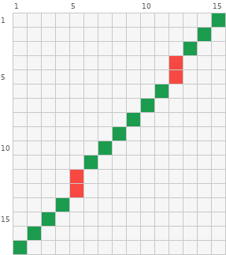
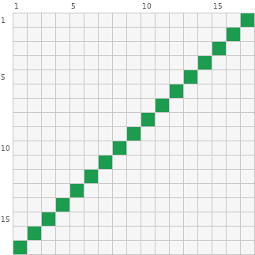
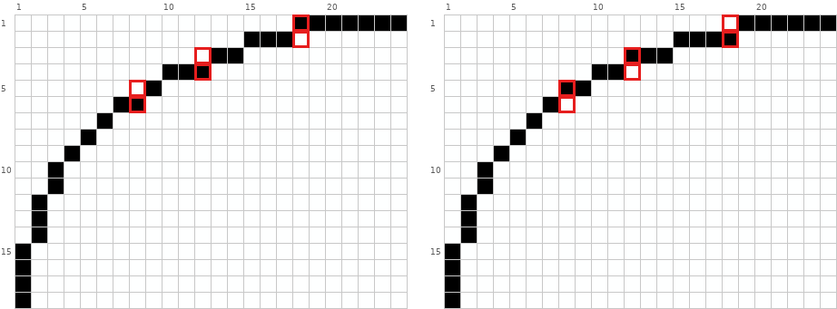
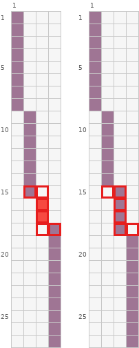
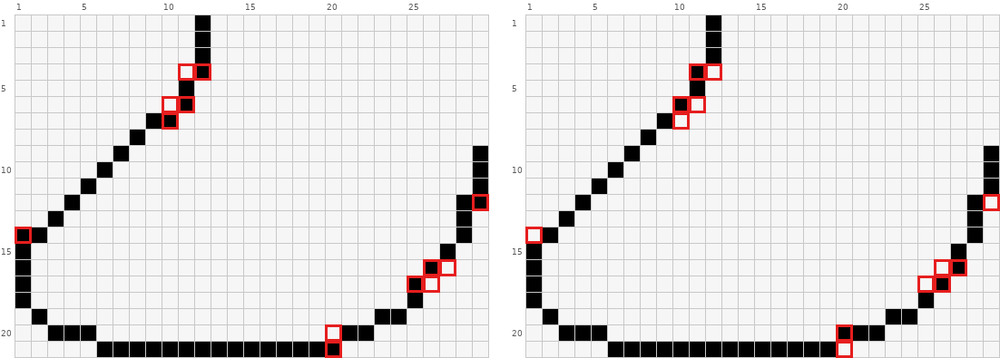

# 描边与线条

像素线条由一段段水平或竖直的「台阶」组成，判断顺不顺主要看段长序列。先认出这段线本来是什么：直线、平滑弧线、拐点，还是底稿有意画的不规则轮廓（毛发、碎石、布料褶皱）。最后一种照底稿保留，不按下面的规则修。读法：沿线走，数每一段连续同行（或同列）的格数，写成数列，如 `8-6-4-9`。矩阵读法见 `pixel-repair-guide.md`。

前两个例子坏例里的 `#` 是标出锯齿位置的标记色，读作线色即可，它标出的就是出问题的格子。

## 1. 直斜线：台阶要等距

**现象。** 一条直的斜线中间出现一个凸起或折角。

**判据。** 直线的段长应一致（如 2-2-2-2），或按固定规律交替（如 2-1-2-1）。一段明显短于或长于相邻段（如 2-1-2-3），就是锯齿。

**修法。** 挪一格，或补删一格，让段长统一。

坏例：



矩阵：

```text
     1  2  3  4  5  6  7  8  9 10 11 12 13 14 15
  1  .  .  .  .  .  .  .  .  .  .  .  .  .  .  @
  2  .  .  .  .  .  .  .  .  .  .  .  .  .  @  .
  3  .  .  .  .  .  .  .  .  .  .  .  .  @  .  .
  4  .  .  .  .  .  .  .  .  .  .  .  #  .  .  .
  5  .  .  .  .  .  .  .  .  .  .  .  #  .  .  .
  6  .  .  .  .  .  .  .  .  .  .  @  .  .  .  .
  7  .  .  .  .  .  .  .  .  .  @  .  .  .  .  .
  8  .  .  .  .  .  .  .  .  @  .  .  .  .  .  .
  9  .  .  .  .  .  .  .  @  .  .  .  .  .  .  .
 10  .  .  .  .  .  .  @  .  .  .  .  .  .  .  .
 11  .  .  .  .  .  @  .  .  .  .  .  .  .  .  .
 12  .  .  .  .  #  .  .  .  .  .  .  .  .  .  .
 13  .  .  .  .  #  .  .  .  .  .  .  .  .  .  .
 14  .  .  .  @  .  .  .  .  .  .  .  .  .  .  .
 15  .  .  @  .  .  .  .  .  .  .  .  .  .  .  .
 16  .  @  .  .  .  .  .  .  .  .  .  .  .  .  .
 17  @  .  .  .  .  .  .  .  .  .  .  .  .  .  .
```

图例（颜色为示意，按作用对应到自己图纸的颜色）：

```text
@  #1C9C4F  森林绿
#  #F74941  鲜红色
.  空位
```

一条一格一阶的 45° 斜线，第 4、5 行第 12 列和第 12、13 行第 5 列各冒出一段 2 格竖段（`#`），段长成了 `1-1-1-2-1-…-2-1-1`，线在这两处像折了一下。

好例：



矩阵：

```text
     1  2  3  4  5  6  7  8  9 10 11 12 13 14 15 16 17
  1  .  .  .  .  .  .  .  .  .  .  .  .  .  .  .  .  @
  2  .  .  .  .  .  .  .  .  .  .  .  .  .  .  .  @  .
  3  .  .  .  .  .  .  .  .  .  .  .  .  .  .  @  .  .
  4  .  .  .  .  .  .  .  .  .  .  .  .  .  @  .  .  .
  5  .  .  .  .  .  .  .  .  .  .  .  .  @  .  .  .  .
  6  .  .  .  .  .  .  .  .  .  .  .  @  .  .  .  .  .
  7  .  .  .  .  .  .  .  .  .  .  @  .  .  .  .  .  .
  8  .  .  .  .  .  .  .  .  .  @  .  .  .  .  .  .  .
  9  .  .  .  .  .  .  .  .  @  .  .  .  .  .  .  .  .
 10  .  .  .  .  .  .  .  @  .  .  .  .  .  .  .  .  .
 11  .  .  .  .  .  .  @  .  .  .  .  .  .  .  .  .  .
 12  .  .  .  .  .  @  .  .  .  .  .  .  .  .  .  .  .
 13  .  .  .  .  @  .  .  .  .  .  .  .  .  .  .  .  .
 14  .  .  .  @  .  .  .  .  .  .  .  .  .  .  .  .  .
 15  .  .  @  .  .  .  .  .  .  .  .  .  .  .  .  .  .
 16  .  @  .  .  .  .  .  .  .  .  .  .  .  .  .  .  .
 17  @  .  .  .  .  .  .  .  .  .  .  .  .  .  .  .  .
```

图例（颜色为示意，按作用对应到自己图纸的颜色）：

```text
@  #1C9C4F  森林绿
.  空位
```

全程一格一阶，段长全是 1。

## 2. 曲线：同一段弯里段长单调变化

**现象。** 弧线看起来一节一节地抖，不圆。

**判据。** 沿同一个弯曲方向的一段弧，段长应单调变化（如 6-4-3-2-2-1-1）；弧线过了最平或最陡的地方、弯曲方向变了，段长可以重新变长，不要求整条曲线一路单调。在同一段弯里，短段夹在两条长段之间（如 3-2-3、2-1-2）就是锯齿。色块内部的明暗分界线也按这条规则走。

**修法。** 削掉凸出的格，或在偏短的段末补一格，让这一段弯里的数列单调。



坏（全图）：

```text
     1  2  3  4  5  6  7  8  9 10 11 12 13 14 15 16 17 18 19 20 21 22 23 24
  1  #  #  #  #  #  #  #  #  #  #  #  #  #  #  #  #  #  @  @  @  @  @  @  @
  2  #  #  #  #  #  #  #  #  #  #  #  #  #  #  @  @  @  #  #  #  #  #  #  #
  3  #  #  #  #  #  #  #  #  #  #  #  #  @  @  #  #  #  #  #  #  #  #  #  #
  4  #  #  #  #  #  #  #  #  #  @  @  @  #  #  #  #  #  #  #  #  #  #  #  #
  5  #  #  #  #  #  #  #  #  @  #  #  #  #  #  #  #  #  #  #  #  #  #  #  #
  6  #  #  #  #  #  #  @  @  #  #  #  #  #  #  #  #  #  #  #  #  #  #  #  #
  7  #  #  #  #  #  @  #  #  #  #  #  #  #  #  #  #  #  #  #  #  #  #  #  #
  8  #  #  #  #  @  #  #  #  #  #  #  #  #  #  #  #  #  #  #  #  #  #  #  #
  9  #  #  #  @  #  #  #  #  #  #  #  #  #  #  #  #  #  #  #  #  #  #  #  #
 10  #  #  @  #  #  #  #  #  #  #  #  #  #  #  #  #  #  #  #  #  #  #  #  #
 11  #  #  @  #  #  #  #  #  #  #  #  #  #  #  #  #  #  #  #  #  #  #  #  #
 12  #  @  #  #  #  #  #  #  #  #  #  #  #  #  #  #  #  #  #  #  #  #  #  #
 13  #  @  #  #  #  #  #  #  #  #  #  #  #  #  #  #  #  #  #  #  #  #  #  #
 14  #  @  #  #  #  #  #  #  #  #  #  #  #  #  #  #  #  #  #  #  #  #  #  #
 15  @  #  #  #  #  #  #  #  #  #  #  #  #  #  #  #  #  #  #  #  #  #  #  #
 16  @  #  #  #  #  #  #  #  #  #  #  #  #  #  #  #  #  #  #  #  #  #  #  #
 17  @  #  #  #  #  #  #  #  #  #  #  #  #  #  #  #  #  #  #  #  #  #  #  #
 18  @  #  #  #  #  #  #  #  #  #  #  #  #  #  #  #  #  #  #  #  #  #  #  #
```

好（全图）：

```text
     1  2  3  4  5  6  7  8  9 10 11 12 13 14 15 16 17 18 19 20 21 22 23 24
  1  #  #  #  #  #  #  #  #  #  #  #  #  #  #  #  #  #  #  @  @  @  @  @  @
  2  #  #  #  #  #  #  #  #  #  #  #  #  #  #  @  @  @  @  #  #  #  #  #  #
  3  #  #  #  #  #  #  #  #  #  #  #  @  @  @  #  #  #  #  #  #  #  #  #  #
  4  #  #  #  #  #  #  #  #  #  @  @  #  #  #  #  #  #  #  #  #  #  #  #  #
  5  #  #  #  #  #  #  #  @  @  #  #  #  #  #  #  #  #  #  #  #  #  #  #  #
  6  #  #  #  #  #  #  @  #  #  #  #  #  #  #  #  #  #  #  #  #  #  #  #  #
  7  #  #  #  #  #  @  #  #  #  #  #  #  #  #  #  #  #  #  #  #  #  #  #  #
  8  #  #  #  #  @  #  #  #  #  #  #  #  #  #  #  #  #  #  #  #  #  #  #  #
  9  #  #  #  @  #  #  #  #  #  #  #  #  #  #  #  #  #  #  #  #  #  #  #  #
 10  #  #  @  #  #  #  #  #  #  #  #  #  #  #  #  #  #  #  #  #  #  #  #  #
 11  #  #  @  #  #  #  #  #  #  #  #  #  #  #  #  #  #  #  #  #  #  #  #  #
 12  #  @  #  #  #  #  #  #  #  #  #  #  #  #  #  #  #  #  #  #  #  #  #  #
 13  #  @  #  #  #  #  #  #  #  #  #  #  #  #  #  #  #  #  #  #  #  #  #  #
 14  #  @  #  #  #  #  #  #  #  #  #  #  #  #  #  #  #  #  #  #  #  #  #  #
 15  @  #  #  #  #  #  #  #  #  #  #  #  #  #  #  #  #  #  #  #  #  #  #  #
 16  @  #  #  #  #  #  #  #  #  #  #  #  #  #  #  #  #  #  #  #  #  #  #  #
 17  @  #  #  #  #  #  #  #  #  #  #  #  #  #  #  #  #  #  #  #  #  #  #  #
 18  @  #  #  #  #  #  #  #  #  #  #  #  #  #  #  #  #  #  #  #  #  #  #  #
```

差异格：(1,18) `@`→`#`；(2,18) `#`→`@`；(3,12) `#`→`@`；(4,12) `@`→`#`；(5,8) `#`→`@`；(6,8) `@`→`#`。

图例（颜色为示意，按作用对应到自己图纸的颜色）：

```text
@  #000000  黑色
#  #FEFFFF  纯白
.  空位
```

从右上往左下数横向段长。坏例：`7-3-2-3-1-2-1…`，第 3、4 行的 `2-3` 和第 5、6 行的 `1-2` 都是先短后长，弧线在这两处鼓了出来。好例：`6-4-3-2-2-1-1…`，一路单调变短；过了 45° 以后改数竖向段长，`1-1-2-3-4` 单调变长。差异只有 6 格，都是把某段末尾的一格挪到相邻行。

再看一条接近竖直的缓弧：



坏（全图）：

```text
     1  2  3  4
  1  @  .  .  .
  2  @  .  .  .
  3  @  .  .  .
  4  @  .  .  .
  5  @  .  .  .
  6  @  .  .  .
  7  @  .  .  .
  8  @  .  .  .
  9  .  @  .  .
 10  .  @  .  .
 11  .  @  .  .
 12  .  @  .  .
 13  .  @  .  .
 14  .  @  .  .
 15  .  @  .  .
 16  .  .  #  .
 17  .  .  #  .
 18  .  .  .  @
 19  .  .  .  @
 20  .  .  .  @
 21  .  .  .  @
 22  .  .  .  @
 23  .  .  .  @
 24  .  .  .  @
 25  .  .  .  @
 26  .  .  .  @
 27  .  .  .  @
```

好（全图）：

```text
     1  2  3  4
  1  @  .  .  .
  2  @  .  .  .
  3  @  .  .  .
  4  @  .  .  .
  5  @  .  .  .
  6  @  .  .  .
  7  @  .  .  .
  8  @  .  .  .
  9  .  @  .  .
 10  .  @  .  .
 11  .  @  .  .
 12  .  @  .  .
 13  .  @  .  .
 14  .  @  .  .
 15  .  .  @  .
 16  .  .  @  .
 17  .  .  @  .
 18  .  .  @  .
 19  .  .  .  @
 20  .  .  .  @
 21  .  .  .  @
 22  .  .  .  @
 23  .  .  .  @
 24  .  .  .  @
 25  .  .  .  @
 26  .  .  .  @
 27  .  .  .  @
```

差异格：(15,2) `@`→`.`；(15,3) `.`→`@`；(16,3) `#`→`@`；(17,3) `#`→`@`；(18,3) `.`→`@`；(18,4) `@`→`.`。

图例（颜色为示意，按作用对应到自己图纸的颜色）：

```text
@  #9F7594  紫灰色
#  #F74941  鲜红色
.  空位
```

坏例竖向的段长是 `8-7-2-10`：第 3 列只有第 16、17 行两格（`#`），夹在两段长段之间，像折了一下。好例改成 `8-6-4-9`：前三段一路变短，弯曲方向变了以后最后一段重新变长，只动了 6 格。

## 3. 曲线转角：不要突然插入反方向的段

**现象。** 一条接近 45° 的弧线中途出现一段水平的 2 格，看起来像折了一下。

**判据。** 段长数列里，竖段一路是 1，中间突然冒出一个横段 2（或反过来），就是转角突变。

**修法。** 把这一段拆开，让段长从 2 逐步过渡到 1。



坏（第 1–16 行、第 1–13 列）：

```text
     1  2  3  4  5  6  7  8  9 10 11 12 13
  1  .  .  .  .  .  .  .  .  .  .  .  @  .
  2  .  .  .  .  .  .  .  .  .  .  .  @  .
  3  .  .  .  .  .  .  .  .  .  .  .  @  .
  4  .  .  .  .  .  .  .  .  .  .  .  @  .
  5  .  .  .  .  .  .  .  .  .  .  @  .  .
  6  .  .  .  .  .  .  .  .  .  .  @  .  .
  7  .  .  .  .  .  .  .  .  @  @  .  .  .
  8  .  .  .  .  .  .  .  @  .  .  .  .  .
  9  .  .  .  .  .  .  @  .  .  .  .  .  .
 10  .  .  .  .  .  @  .  .  .  .  .  .  .
 11  .  .  .  .  @  .  .  .  .  .  .  .  .
 12  .  .  .  @  .  .  .  .  .  .  .  .  .
 13  .  .  @  .  .  .  .  .  .  .  .  .  .
 14  @  @  .  .  .  .  .  .  .  .  .  .  .
 15  @  .  .  .  .  .  .  .  .  .  .  .  .
 16  @  .  .  .  .  .  .  .  .  .  .  .  .
```

好（第 1–16 行、第 1–13 列）：

```text
     1  2  3  4  5  6  7  8  9 10 11 12 13
  1  .  .  .  .  .  .  .  .  .  .  .  @  .
  2  .  .  .  .  .  .  .  .  .  .  .  @  .
  3  .  .  .  .  .  .  .  .  .  .  .  @  .
  4  .  .  .  .  .  .  .  .  .  .  @  .  .
  5  .  .  .  .  .  .  .  .  .  .  @  .  .
  6  .  .  .  .  .  .  .  .  .  @  .  .  .
  7  .  .  .  .  .  .  .  .  @  .  .  .  .
  8  .  .  .  .  .  .  .  @  .  .  .  .  .
  9  .  .  .  .  .  .  @  .  .  .  .  .  .
 10  .  .  .  .  .  @  .  .  .  .  .  .  .
 11  .  .  .  .  @  .  .  .  .  .  .  .  .
 12  .  .  .  @  .  .  .  .  .  .  .  .  .
 13  .  .  @  .  .  .  .  .  .  .  .  .  .
 14  .  @  .  .  .  .  .  .  .  .  .  .  .
 15  @  .  .  .  .  .  .  .  .  .  .  .  .
 16  @  .  .  .  .  .  .  .  .  .  .  .  .
```

差异格：(4,11) `.`→`@`；(4,12) `@`→`.`；(6,10) `.`→`@`；(6,11) `@`→`.`；(7,10) `@`→`.`；(14,1) `@`→`.`。

图例（颜色为示意，按作用对应到自己图纸的颜色）：

```text
@  #000000  黑色
.  空位
```

看左侧弧线：坏例从顶部下来，第 12 列是 4 格竖段（第 1 到 4 行），然后第 7 行第 9、10 列突然出现一段横向 2 格，第 14 行第 1、2 列又是一段横向 2 格，弧线在这两处折角。好例第 12 列缩成 3 格，第 11 列 2 格，之后一格一阶走到底，两处横段都消掉了。

## 4. 线宽与断口

- **线宽沿用底稿。** 判据：底稿这条描边是 1 格宽，图纸上局部却变成 2 格，或者中间断了，内部因此挤压变形。底稿本来就用粗线，或有意让粗细变化（外轮廓粗、内线细，暗部一侧加粗），照底稿保留。修法：削回底稿的线宽，断口补上，补的颜色取断口两侧描边的颜色。描边中间缺一格，会读成两条线。
- **主体和背景混在一起。** 判据：底稿有一圈封闭描边，图纸上这圈断了，主体与空位或相近色直接相接。修法：沿断口补回 1 格描边色，让轮廓闭合。
- **45° 线不需要过渡色。** 一格一阶的斜线本身就是平滑的。

## 5. 粗细、颜色与风格

- **线条想显粗或显细，换颜色而不是加格。** 深色显粗，接近底色的浅色显细；线条末端换成浅一档的颜色就有渐尖的效果。例子见 `repair-face.md` 的嘴缝一节。
- **内部的黑线把色块切碎。** 判据：底稿内部结构用的是深一档的颜色，图纸上却成了纯黑线，显得脏。修法：改成相邻色块的最深一档，或去掉线、用明暗交界自己形成分界。例子见 `repair-face.md` 的「面部内的黑线改成色块交界」。
- **轮廓风格要统一。** 常见几种：没有描边，只靠色块对比；最外圈 1 格黑线，内部用深浅过渡；彩色描边，每块颜色外缘用它自己最深的那档；受光一侧的描边变浅、背光一侧保持深色。修复时沿用底稿的那一种，不要在一张图里混用。
